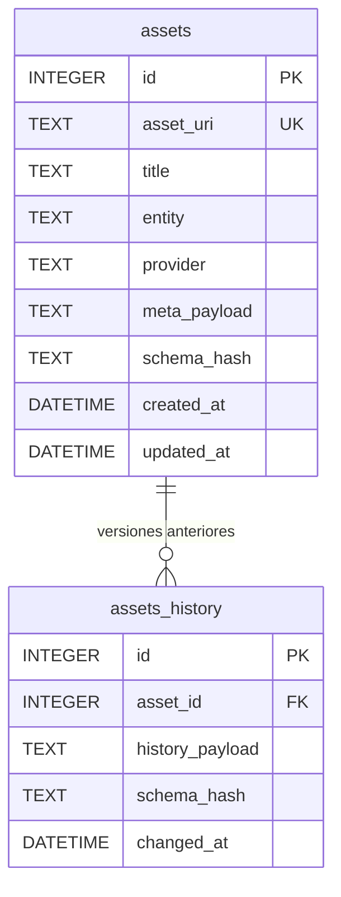

# Base de datos

Análisis del modelo de datos del cliente de Google Sheets: qué se guarda, cómo se relacionan las tablas, cómo se versiona y cómo crear y verificar la base. La definición ejecutable está en [`db/schema.sql`](../db/schema.sql).

## Modelo de datos

La persistencia es un **archivo SQLite** (por defecto `db/redes2.db`) con dos tablas:

| Tabla | Qué guarda |
|---|---|
| `assets` | El estado **vigente** de cada spreadsheet consultada: una fila por spreadsheet. |
| `assets_history` | Las versiones **anteriores** de una spreadsheet, una fila cada vez que cambió su estructura. |

El recurso externo se guarda de forma **polimórfica**: el JSON validado de la respuesta va en una columna `TEXT` (`meta_payload`), bajo un esquema fijo de tablas. Así, si Google agrega o quita campos, no hace falta modificar las tablas.

A diferencia de un worker con cola de tareas, acá no hay tabla de tareas ni de eventos: el Contrato excluye la cola con control de concurrencia, y el programa procesa una spreadsheet por ejecución.

## Entidades

### `assets`

| Campo | Tipo | Descripción |
|---|---|---|
| `id` | INTEGER | Identificador (clave primaria, autoincremental) |
| `asset_uri` | TEXT | URL canónica de la spreadsheet: `https://docs.google.com/spreadsheets/d/<spreadsheetId>`. Única. |
| `title` | TEXT | Título de la spreadsheet (`properties.title`) |
| `entity` | TEXT | Constante `spreadsheet` |
| `provider` | TEXT | Constante `google_sheets` |
| `meta_payload` | TEXT | JSON validado de la respuesta (`properties` + `sheets`), sin campos desconocidos |
| `schema_hash` | TEXT | SHA-256 (64 caracteres hexadecimales) de la estructura del payload |
| `created_at` | DATETIME | Fecha de la primera captura (la pone la base al insertar) |
| `updated_at` | DATETIME | Fecha de la última captura (la actualiza el programa en cada `UPDATE`) |

### `assets_history`

| Campo | Tipo | Descripción |
|---|---|---|
| `id` | INTEGER | Identificador (clave primaria, autoincremental) |
| `asset_id` | INTEGER | Spreadsheet a la que pertenece (clave foránea a `assets.id`) |
| `history_payload` | TEXT | Copia del `meta_payload` que había antes del cambio |
| `schema_hash` | TEXT | Hash de la estructura que tenía esa copia |
| `changed_at` | DATETIME | Momento en que se reemplazó esa versión |

## Diagrama entidad-relación



Una spreadsheet (`assets`) puede tener cero o muchas versiones anteriores (`assets_history`). Si se borra una spreadsheet, su historial se borra con ella (`ON DELETE CASCADE`).

## Flujo de datos

Después de validar la respuesta y calcular el `schema_hash`, el programa busca la spreadsheet por `asset_uri`:

```text
SELECT id, schema_hash FROM assets WHERE asset_uri = ?
        │
        ├── no existe ───────────► INSERT en assets
        │
        ├── existe, mismo hash ──► UPDATE de meta_payload, title y updated_at
        │
        └── existe, otro hash ───► (una sola transacción)
                                   1. copiar el estado actual a assets_history
                                   2. UPDATE de assets con el payload nuevo
```

El cambio de estructura se resuelve en una única transacción, para que nunca quede un `UPDATE` sin su copia en el historial:

```sql
BEGIN;

INSERT INTO assets_history (asset_id, history_payload, schema_hash)
SELECT id, meta_payload, schema_hash
FROM assets
WHERE asset_uri = ?;

UPDATE assets
SET title = ?, meta_payload = ?, schema_hash = ?, updated_at = CURRENT_TIMESTAMP
WHERE asset_uri = ?;

COMMIT;
```

Qué se considera "cambio de estructura" está definido en el README (sección *Versionado de schema*): cambia el hash cuando un campo opcional aparece o desaparece, no cuando cambian los valores ni la cantidad de pestañas.

## Qué rechaza la base

Las restricciones del schema impiden guardar datos inválidos aunque el programa tenga un error. Se probaron con SQLite 3.53.1:

| Intento | Restricción | Resultado |
|---|---|---|
| Guardar un JSON mal formado | `CHECK(json_valid(...))` | `CHECK constraint failed: json_valid(meta_payload)` |
| `entity` distinta de `spreadsheet` | `CHECK(entity = 'spreadsheet')` | `CHECK constraint failed: entity = 'spreadsheet'` |
| Hash que no tiene 64 caracteres | `CHECK(length(schema_hash) = 64)` | `CHECK constraint failed: length(schema_hash) = 64` |
| Dos filas con la misma `asset_uri` | `UNIQUE` | `UNIQUE constraint failed: assets.asset_uri` |
| Historial de una spreadsheet inexistente | Clave foránea | `FOREIGN KEY constraint failed` |
| Borrar una spreadsheet con historial | `ON DELETE CASCADE` | El historial se borra con ella |

Las claves foráneas solo se validan si cada conexión ejecuta `PRAGMA foreign_keys = ON;`. El programa debe hacerlo al abrir la base (`schema.sql` lo incluye).

## Paso a paso para crear la base

### 1. Definición del schema

La estructura vive en `db/schema.sql`. Todas las sentencias usan `IF NOT EXISTS`, así que puede ejecutarse más de una vez sin riesgo.

### 2. Creación del archivo

Con el cliente:

```bash
./sheets_client --init-db
```

O, si tenés la CLI de SQLite instalada (`sudo apt install sqlite3`):

```bash
sqlite3 db/redes2.db < db/schema.sql
```

### 3. Verificación

```bash
sqlite3 db/redes2.db
```

```sql
.tables
```

Resultado esperado:

```text
assets          assets_history
```

Y para ver la definición de una tabla:

```sql
.schema assets
```

## Consultas útiles

Estado vigente de las spreadsheets guardadas:

```sql
SELECT id, asset_uri, title, schema_hash, updated_at FROM assets;
```

Historial de cambios de estructura de una spreadsheet, del más antiguo al más reciente:

```sql
SELECT changed_at, schema_hash
FROM assets_history
WHERE asset_id = 1
ORDER BY changed_at;
```

Cuántas veces cambió la estructura de cada spreadsheet:

```sql
SELECT a.asset_uri, COUNT(h.id) AS cambios_de_estructura
FROM assets a
LEFT JOIN assets_history h ON h.asset_id = a.id
GROUP BY a.id;
```

Leer datos dentro del JSON sin salir de SQL:

```sql
SELECT json_extract(meta_payload, '$.properties.title') AS titulo,
       json_array_length(meta_payload, '$.sheets')      AS cantidad_de_pestanas
FROM assets;
```

Estas consultas responden al criterio de aceptación 7 del Contrato: a partir de la base se sabe qué spreadsheet se guardó, cuándo fue su última captura y cuándo cambió su estructura.

## Decisiones de diseño

- **JSON como `TEXT`:** el schema del proveedor no es estable. Guardar el payload completo evita migrar tablas cada vez que Google cambia la respuesta.
- **`schema_hash` como columna aparte:** permite saber si cambió la estructura comparando 64 caracteres, sin tener que leer y recorrer el JSON guardado.
- **Historial solo ante cambios de estructura:** si cambia un valor (por ejemplo, el título) se actualiza `assets` sin generar historial. Es una decisión consciente: el objetivo es versionar el schema del proveedor, no cada dato.
- **Índice sobre `assets_history(asset_id)`:** SQLite no crea índices automáticos sobre claves foráneas. Sin él, buscar el historial de una spreadsheet recorre toda la tabla.
- **Requisito de versión:** las funciones `json_valid`, `json_extract` y `json_array_length` vienen incluidas desde SQLite 3.38. Si tu `libsqlite3` es más vieja y falta alguna, hay que actualizarla.