# Workplan

**Fecha estimada de entrega:** viernes 4 de diciembre de 2026.

> La columna "Duración" es fija (son las estimaciones por tarea); las columnas de fecha se completan y se van actualizando a medida que avanza el proyecto — los cambios deben quedar reflejados en los commits correspondientes.

## Cronograma

| # | Tarea | Duración | Fecha inicio | Fecha fin | Depende de |
|---|-------|----------|--------------|-----------|------------|
| T0 | Contrato, Workplan y README iniciales (hecho) | 2 días | 17/11/26 | 18/11/26 | — |
| T1 | Configurar API Key en Cloud Console + `02-API_SETUP.md` | 1 día | 18/11/26 | 18/11/26 | T0 |
| T2 | Diseñar schema SQLite (`assets`, `assets_history`) + `01-BDD.md` | 1 día | _(completar)_ | _(completar)_ | T0 |
| T3 | Implementar socket TCP manual | 2 días | _(completar)_ | _(completar)_ | T1 |
| T4 | Implementar TLS con OpenSSL sobre el socket | 2 días | _(completar)_ | _(completar)_ | T3 |
| T5 | Armar request HTTP manual (GET) + parseo de URL/ID | 1 día | _(completar)_ | _(completar)_ | T4 |
| T6 | Parsear JSON de la respuesta + validar contra schema fijo | 2 días | _(completar)_ | _(completar)_ | T5 |
| T7 | Persistir payload en SQLite (`assets`) | 1 día | _(completar)_ | _(completar)_ | T2, T6 |
| T8 | Calcular hash de schema + versionado (`assets_history`) | 2 días | _(completar)_ | _(completar)_ | T7 |
| T9 | Manejo de errores HTTP + manejo controlado de cambios de schema | 1 día | _(completar)_ | _(completar)_ | T8 |
| T10 | Testing end-to-end + evidencia de implementación (`04-Evidencias.md`) | 2-4 días | _(completar)_ | _(completar)_ | T9 |
| T11 | README final + `03-Implementacion.md` | 2 días | _(completar)_ | _(completar)_ | T9 |
| T13 | Buffer / contingencia | 1 día | _(completar)_ | _(completar)_ | T10, T11 |
| T12 | Entrega final | — | _(completar)_ | _(completar)_ | T13 |

**Duración total del camino crítico:** de 15 a 17 días de esfuerzo (T1→T3→T4→T5→T6→T7→T8→T9→T10→T13→T12). T0 ya está completada y T11 corre en paralelo con T10, por lo que no alarga el camino.

**Riesgos de Testing/Modificaciones:** el testing (T10) queda al final de la cadena. Se practicarán tests para probar cada bloque apenas se termine (compila, conecta el socket, llega la respuesta) en lugar de dejar toda la validación para el final del cronograma y así evitar grandes modificaciones.

## Diagrama PERT

```mermaid
graph LR
    T0["T0: Contrato, Workplan y README iniciales (2d, hecho)"] --> T1
    T0 --> T2
    T1["T1: API Key + 02-API_SETUP (1d)"] --> T3
    T2["T2: Schema SQLite + 01-BDD (1d)"] --> T7
    T3["T3: Socket TCP (2d)"] --> T4["T4: TLS OpenSSL (2d)"]
    T4 --> T5["T5: Request HTTP (1d)"]
    T5 --> T6["T6: Parseo JSON + validación (2d)"]
    T6 --> T7["T7: Persistencia SQLite (1d)"]
    T7 --> T8["T8: Hash + versionado (2d)"]
    T8 --> T9["T9: Manejo errores (1d)"]
    T9 --> T10["T10: Testing + 04-Evidencias (2-4d)"]
    T9 --> T11["T11: README final + 03-Implementacion (2d)"]
    T10 --> T13["T13: Buffer (1d)"]
    T11 --> T13
    T13 --> T12["T12: Entrega 4/12"]
```

